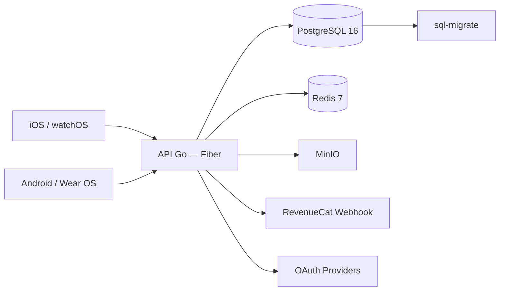

---
tags:
  - backend
  - go
  - arquitectura
aliases:
  - Backend Arquitectura
platform: backend
type: architecture
status: active
date: 2026-04-17
updated: 2026-04-20
---

# Backend - Arquitectura General

> [!abstract] Resumen
> Backend en Go organiza auth, sync, billing y observabilidad como base comun para iOS, Android, watchOS y Wear OS.

## Stack

| Capa | Tecnologia |
|---|---|
| API | Go + Fiber v2.52 |
| ORM | GORM |
| Persistencia | PostgreSQL 16 + migraciones sql-migrate |
| Cache / Sesiones | Redis 7 (JWT refresh token store) |
| Storage | MinIO (objetos/avatars) |
| Seguridad | JWT access+refresh, CORS, rate-limit via Fiber middleware |
| Integraciones | RevenueCat webhooks, Sign in with Apple, Google OAuth |
| Operacion | Docker Compose + Caddy (TLS reverse proxy) |

## Flujo alto nivel

## URL base

| Entorno | URL |
|---|---|
| Producción | `https://api.ppn.creapolis.dev` |
| Local dev | `http://localhost:8080` |
| Postgres local | `localhost:5433` (evita conflicto con instancias locales) |

## Grupos de endpoints

| Grupo | Prefijo | Descripción |
|---|---|---|
| Auth | `/api/v1/auth/` | register, login, OAuth, refresh, logout |
| Usuario | `/api/v1/users/` | perfil, preferencias |
| Tareas | `/api/v1/tasks/` | CRUD tareas + subtareas |
| Sync | `/api/v1/sync/` | full, sessions, initial-upload |
| Preferencias | `/api/v1/preferences/` | upsert |
| Billing | `/api/v1/billing/` | verify purchase |
| Webhooks | `/api/v1/webhooks/` | revenuecat |
| WebSocket | `/ws` | notificaciones en tiempo real (solo push) |
| Dispositivos | `/api/v1/devices/` | registro de push tokens |

> [!tip] Contrato iOS completo
> Ver [[API Contract iOS]] para payload exacto de cada endpoint.

## Responsabilidades

- Identidad y sesion de usuario.
- Sincronizacion de tareas/sesiones.
- Reglas de monetizacion y entitlement.
- API estable para paridad cross-platform.

## Regla de versionado

> [!warning] Impacto multiplataforma
> Cada cambio en contrato API debe actualizar pruebas y documentacion de clientes iOS/Android + impactos watch/wear.

Ver tambien: [[Autenticacion & Suscripciones]] y [[../Cross-Platform/Parity Matrix|Parity Matrix]]
