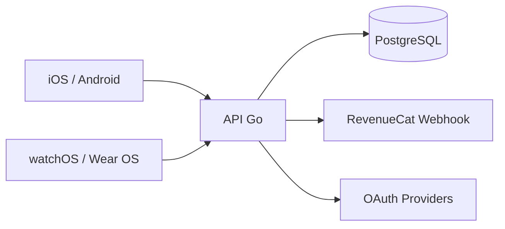

---
tags:
  - backend
  - go
  - arquitectura
aliases:
  - Backend Arquitectura
platform: backend
type: architecture
status: active
date: 2026-04-17
updated: 2026-04-17
---

# Backend - Arquitectura General

> [!abstract] Resumen
> Backend en Go organiza auth, sync, billing y observabilidad como base comun para iOS, Android, watchOS y Wear OS.

## Stack

| Capa | Tecnologia |
|---|---|
| API | Go + Chi |
| Persistencia | PostgreSQL + migraciones |
| Seguridad | JWT + middlewares |
| Integraciones | RevenueCat webhooks, OAuth providers |
| Operacion | Docker Compose + Caddy |

## Flujo alto nivel

## Responsabilidades

- Identidad y sesion de usuario.
- Sincronizacion de tareas/sesiones.
- Reglas de monetizacion y entitlement.
- API estable para paridad cross-platform.

## Regla de versionado

> [!warning] Impacto multiplataforma
> Cada cambio en contrato API debe actualizar pruebas y documentacion de clientes iOS/Android + impactos watch/wear.

Ver tambien: [[Autenticacion & Suscripciones]] y [[../Cross-Platform/Parity Matrix|Parity Matrix]]
